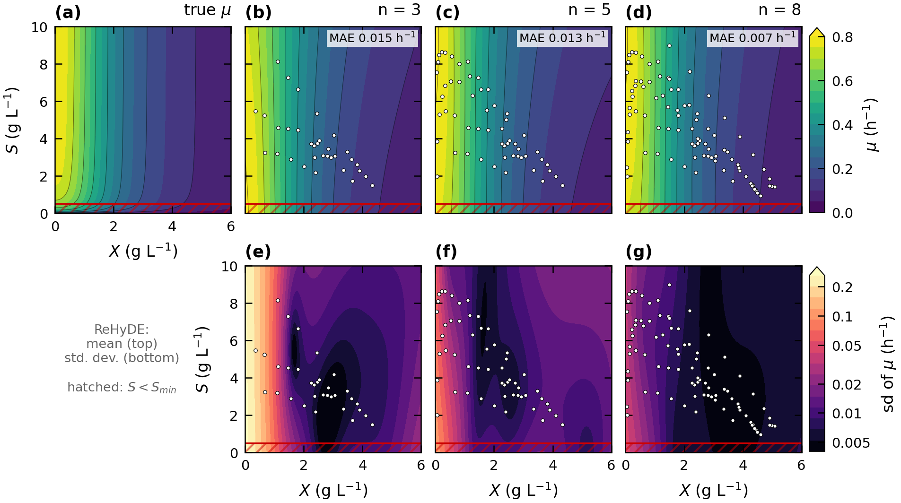
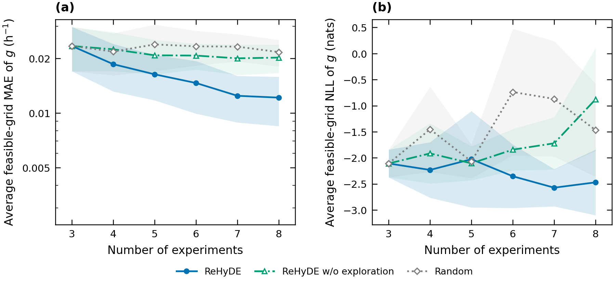

# ReHyDE — chemostat case study

**ReHyDE** (**Re**gion-constrained **Hy**brid **D**ynamics **E**xploration) designs
experiments to learn the unknown part of a hybrid mechanistic / data-driven model.
A deep-kernel-learning (DKL) closure replaces the unknown kinetics inside known
mass balances, and each new experiment is chosen to maximise the closure
uncertainty integrated along the predicted trajectory, subject to a chance
constraint that keeps the process in the admissible operating region.

This repository contains the two-state chemostat case study: an ablation that
isolates what each component of ReHyDE contributes.

## Results at a glance

After **3 initial + 5 designed experiments**, over **15 repeats**:

| | ReHyDE | w/o hybrid | w/o exploration | Random |
|---|---|---|---|---|
| Closure MAE [10⁻² h⁻¹] | **1.19 ± 0.37** | — | 1.99 ± 0.36 | 2.14 ± 0.36 |
| Closure NLL | **−2.51 ± 0.63** | — | −0.93 ± 0.99 | −1.49 ± 0.90 |
| Trajectory MAE, X [g L⁻¹] | **0.020 ± 0.005** | 0.049 ± 0.010 | 0.027 ± 0.009 | 0.023 ± 0.005 |
| Trajectory MAE, S [g L⁻¹] | **0.039 ± 0.010** | 0.129 ± 0.019 | 0.053 ± 0.017 | 0.046 ± 0.010 |
| Coverage X / S [%] (nominal 95) | **90.4 / 90.4** | 90.4 / 81.9 | 83.6 / 83.6 | 89.1 / 89.1 |
| Constraint violations (of 75) | **0** | 1 | 0 | 7 |

Means ± 95 % confidence-interval half-widths. Closure metrics are evaluated on a
160 × 160 grid over the admissible region (S ≥ 0.5 g L⁻¹) and are undefined for the
black box, which has no closure.

- **Exploration recovers the kinetics.** ReHyDE halves the closure error (−48 %),
  against −13 % and −7 % for the uniform designs, and is better in 14/15 and 13/15
  paired repeats (Wilcoxon signed-rank, Holm-adjusted p = 0.008 and 0.001). It is
  the only method whose NLL also improves (Holm-adjusted p = 0.017 against both).
- **The hybrid structure makes sparse data sufficient.** The black box predicts
  held-out trajectories 2.5–3.3× less accurately; ReHyDE after the 3 initial
  experiments already beats it after all 8.
- **The region constraint keeps experiments admissible.** 0 violations for ReHyDE
  against 7 for unconstrained random designs. No method identifies the kinetics
  in the excluded region (S < 0.5, closure MAE ≈ 0.10 h⁻¹ for all), so ReHyDE's
  advantage lies entirely where the model is used.

### Kinetics recovered by ReHyDE (one repeat)

True growth rate μ(X, S) (a), and the ReHyDE posterior mean (b–d) and standard
deviation (e–g) after 3, 5 and 8 experiments. Dots are the observed states; the
hatched band is the excluded region S < S_min. The uncertainty collapses where
the selected experiments go.

### Closure accuracy over all repeats

Average grid MAE (a) and NLL (b) of the learned closure over the admissible
region; lines are means, bands 95 % confidence intervals over 15 repeats.

## Methods compared

Each ablation removes exactly one named component of ReHyDE.

| policy     | model         | name                   | Re | Hy | E |
|------------|---------------|------------------------|----|----|---|
| `hybrid`   | hybrid DKL    | ReHyDE                 | ✓  | ✓  | ✓ |
| `blackbox` | black-box DKL | ReHyDE w/o hybrid      | ✓  | –  | ✓ |
| `crandom`  | hybrid DKL    | ReHyDE w/o exploration | ✓  | ✓  | – |
| `random`   | hybrid DKL    | Random                 | –  | ✓  | – |

- **Re** — chance constraint P(S(t_k) ≥ S_min) ≥ 0.9 at every sampling time
- **Hy** — known mass balances with a DKL closure for the growth rate μ(X, S);
  the black box instead learns dX/dt and dS/dt from (X, S, D)
- **E** — exploration objective: maximise ∫‖σ‖ dt along the predicted mean trajectory

`crandom` draws recipes uniformly and keeps those satisfying the same chance
constraint, isolating the exploration objective. `random` is an unconstrained
uniform design; it uses no model to choose experiments and is refit with the
hybrid model for evaluation.

## The case study

Chemostat with known balances

    dX/dt = μ(X,S)·X − D·X
    dS/dt = −μ(X,S)·X / Y + D·(S_in − S)

and withheld kinetics μ = 0.8 · S/(0.1 + S) · 1/(1 + 0.3 X²), Y = 0.5,
S_in = 10 g L⁻¹ (about 90 % of the input space is feasible). Each 10 h experiment
is set by u = (X0, S0, D1…D5), X0 ∈ [0.05, 1.5], S0 ∈ [2, 9] g L⁻¹, each
D ∈ [0.02, 0.30] h⁻¹ held for 2 h. Both states are measured hourly (11 points) with
additive Gaussian noise, Σ = diag(0.01², 0.02²) g² L⁻².

## Installation

    pip install -r requirements.txt        # Python >= 3.10

## Reproducing the results

    python run.py                          # 4 methods x 15 repeats -> results_final/
    python figures_v2.py results_final 5   # all figures + metric tables, for repeat 5
    python chemostat_todos.py results_final 4096   # feasible fraction; error in/out of region

Methods and seeds write separate files (`{policy}_s{seed}.json`), so they can be run
as parallel processes, e.g. `python run.py --policies hybrid --seeds 0 1 2`.
Every trained model is saved to `results_final/checkpoints/` and can be reloaded
with `models.load_model(path)`. A full run takes a few hours on one CPU core.

Main settings:

| setting | where | value |
|---|---|---|
| initial / designed experiments | `run.py` `N_INIT, N_ROUNDS` | 3 / 5 |
| model refit | `run.py` `REFIT_EVERY` | 1 (from scratch after every experiment) |
| acquisition uncertainty | `models.py` `ACQ_SIGMA` | `"closure"` or `"induced"` |
| measurement noise | `plant.py` `SIG_X, SIG_S` | 0.01, 0.02 g L⁻¹ |
| torch threads | env `TORCH_THREADS` | 1 (tiny tensors: faster single-threaded) |

## Implementation notes

**Training (`fit.py`).** Multiple shooting: every 1 h interval between measurements
is a segment integrated from the measured state with RK4 (0.5 h steps,
`torchdiffeq`); residuals are whitened by Σ. Phase 1 fits the posterior mean;
phase 2 maximises a Monte Carlo ELBO over posterior realizations with the feature
network frozen. The DKL is a tanh MLP (5-5-4) feeding a sparse variational GP with
5 inducing points per experiment.

**Acquisition (`acquisition.py`).** A 1024-point Sobol screen, then Nelder–Mead with
an exact L1 penalty on the chance constraint, multistarted from 4 distinct
candidates and advanced in lockstep so each iteration is one batched rollout.
Feasibility uses a continuous margin (α-quantile over posterior samples of
S(t_k) − S_min) that defines exactly the same feasible set as the sample fraction.

**Metrics (`figures_v2.py`).** Closure MAE / NLL on the admissible grid; trajectory
MAE and coverage of the 95 % predictive interval on 100 held-out feasible test
experiments, propagating 64 posterior realizations; paired statistics over repeats.

## Files

| file | content |
|---|---|
| `plant.py` | true plant, input bounds, noise model |
| `dkl.py` | DKL closure (feature network + sparse variational GP) |
| `fit.py` | trajectory training (multiple shooting, ELBO) |
| `models.py` | hybrid and black-box models, rollouts, checkpoints |
| `acquisition.py` | ReHyDE acquisition and the constrained-random ablation |
| `run.py` | campaigns, per-round metrics, checkpointing |
| `figures_v2.py` | figures (PDF + PNG) and metric tables |
| `chemostat_todos.py` | feasible fraction of the input space; closure error inside / outside the admissible region |

## Citation

Paper in preparation — citation to follow.
